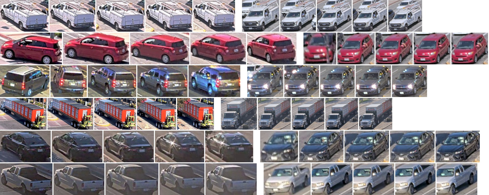

# DOV-VeRi sample: six vehicles from the Dual Opposite Views Vehicle Re-ID dataset

This repository holds a small, fully documented sample of **DOV-VeRi**, the dataset introduced in

> C. Wei, Z. Qin, Y. Liu, E. A. Sisbot, K. Oguchi, G. Wu, and M. J. Barth,
> "DOV-VeRi: A Real-World Vehicle Re-identification Dataset and Benchmark for Cross-View Scenarios with Opposing Camera Perspectives,"
> submitted to *IEEE Transactions on Intelligent Transportation Systems* (manuscript T-ITS-26-02-0747).

The sample lets a reader inspect the file layout, the crop quality, the trajectory format and the evaluation protocol before downloading the full benchmark subset (926 vehicles, 9,260 crops, 138 MB). The full subset and the baseline checkpoints are released on request from the corresponding author while the paper is under review, and will be linked here on acceptance.



Rows from top to bottom: 2033, 3067, 4016, 6013, 12090, 13045. The five crops on the left are the CAM1 (rear) track, the five on the right are the CAM2 (front) track of the same vehicle.

## What is in the sample

| ID | Session | Split | Vehicle | Lighting | CAM1 median crop (w x h) | CAM2 median crop (w x h) |
|---|---|---|---|---|---|---|
| 2033 | 2 | train | white pickup | day | 175 x 115 | 190 x 173 |
| 3067 | 3 | train | red hatchback | day | 138 x 74 | 127 x 109 |
| 4016 | 4 | test | grey SUV | **night** (the only night session of the dataset) | 136 x 89 | 155 x 142 |
| 6013 | 6 | val | white truck with trailer | day | 359 x 272 | 321 x 312 |
| 12090 | 12 | train | black sedan | day | 113 x 71 | 147 x 105 |
| 13045 | 13 | test | silver pickup | day | 130 x 78 | 136 x 106 |

Exact crop sizes, frame ranges and trajectory lengths for every ID and camera are in `sample_index.csv`. Colour and body type above are the attribute predictions of the Qwen3-VL-8B study in the paper (Appendix C) and agree between the two cameras for every sampled vehicle.

The six vehicles come from six different recording sessions and cover the three splits of the benchmark protocol (train, val, test). The ID encodes the session: `session = int(str(id)[:-3])`, so 12090 is vehicle 90 of session 12.

## File layout

```
DOV-VeRi-sample/
  README.md
  LICENSE                 CC BY 4.0
  CITATION.cff
  preview.jpg             montage of the six vehicles (CAM1 left, CAM2 right)
  sample_index.csv        one row per (vehicle, camera)
  data/
    CAM1/<id>/<frame>.jpg     five rear-view crops, file name = frame index in the CAM1 recording
    CAM1/<id>/trajectory.csv  pixel trajectory of the full CAM1 track
    CAM2/<id>/<frame>.jpg     five front-view crops, file name = frame index in the CAM2 recording
    CAM2/<id>/trajectory.csv  pixel trajectory of the full CAM2 track
  protocol/
    split.json            the complete session-disjoint split of the full benchmark (926 IDs)
    proto.py              the evaluator used for every number in the paper
    build_split.py        the script that produced split.json
```

The layout under `data/` is identical to the full release, so code written against this sample runs unchanged on the full benchmark subset.

### Crops

Each vehicle has exactly five JPEG crops per camera, sampled uniformly along its track at 0, 20, 40, 60 and 80 % of the trajectory. Crops are cut from 1920 x 1080 recordings at 60 fps and kept at native resolution, which is why they are small (median 115 x 72 pixels in CAM1 and 106 x 79 in CAM2 over the full benchmark). CAM1 sees the rear of the vehicle, CAM2 sees the front. No image is shared between the two views.

### Trajectories

`trajectory.csv` has three columns:

| column | meaning |
|---|---|
| `Seen` | frame index in that camera's recording (60 fps) |
| `X_Center` | x pixel coordinate of the bounding-box centre |
| `Y_Center` | y pixel coordinate of the bounding-box centre |

The trajectory covers the whole track, not only the five sampled frames. The five crop file names are a subset of the `Seen` column. No experiment in the paper uses the trajectories. They are released so that spatio-temporal methods can be studied on the same data.

### Protocol files

`protocol/split.json` is the split used by every experiment in the paper:

| split | sessions | identities |
|---|---|---|
| train | 1, 2, 3, 5, 7, 8, 10, 12 | 720 |
| val | 6, 9, 11 | 96 |
| test | 4, 13 | 110 |

A query is a vehicle's CAM1 track (five crops), the gallery is the CAM2 track of all 926 vehicles. The track descriptor is the mean of the five crop embeddings, L2 normalised. Exactly one gallery entry is correct per query, so mAP equals mean reciprocal rank. `proto.py` implements this and is kept here unchanged from the full release. Its `Protocol` class asserts the full split sizes, so it will only run end to end on the full data; on this sample it documents the protocol.

## Loading the sample in Python

```python
import csv, glob, os
from PIL import Image

root = "data"
for vid in sorted(os.listdir(f"{root}/CAM1"), key=int):
    rear  = sorted(glob.glob(f"{root}/CAM1/{vid}/*.jpg"), key=lambda p: int(os.path.basename(p)[:-4]))
    front = sorted(glob.glob(f"{root}/CAM2/{vid}/*.jpg"), key=lambda p: int(os.path.basename(p)[:-4]))
    with open(f"{root}/CAM1/{vid}/trajectory.csv") as f:
        traj = list(csv.DictReader(f))
    print(vid, len(rear), len(front), len(traj), Image.open(rear[2]).size)
```

## Privacy

The recordings were made on public roads with fixed roadside cameras. Faces are not resolvable at the released crop size. Licence plates are at or below the resolution limit in most crops. If you find a crop in this sample that you believe should be removed, contact the corresponding author.

## Licence

The data and the preview image are released under [CC BY 4.0](LICENSE). The scripts under `protocol/` are released under the same terms.

## Citation

See `CITATION.cff`. Until the paper is published, please cite the manuscript as listed at the top of this page.

## Contact

Chuheng Wei, University of California, Riverside. chuheng.wei@email.ucr.edu
